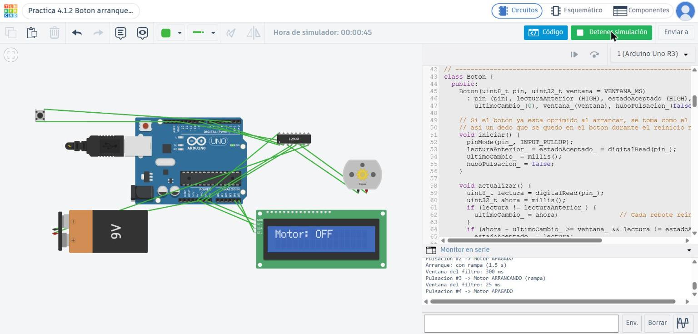

# Botón de arranque y paro a prueba de rebotes y apagones

## Descripción

Esta práctica consiste en controlar el arranque y paro de un motorreductor con un botón conectado a un Arduino UNO R4 WiFi y un puente H L298N. El programa está diseñado para evitar que los rebotes mecánicos del botón se interpreten como varias pulsaciones y para mantener el motor apagado cuando el sistema se reinicia.

Al pulsar el botón una vez, el motor arranca de manera gradual; la siguiente pulsación lo detiene inmediatamente. Cuando se enciende o reinicia el Arduino, el sistema muestra un aviso y espera una nueva pulsación antes de volver a arrancar.

## Objetivos

- Implementar un botón de arranque y paro para controlar un motorreductor.
- Aplicar un filtro antirrebote utilizando `millis()`.
- Arrancar el motor mediante una rampa gradual de PWM.
- Detener el motor inmediatamente cuando se presiona el botón durante el funcionamiento.
- Evitar que el motor arranque solo después de un reinicio o apagón.
- Observar el estado del sistema mediante la matriz LED y el Monitor Serie.
- Comparar el comportamiento del botón con y sin filtro antirrebote.

## Herramientas y material utilizado

- Arduino UNO R4 WiFi.
- Módulo puente H L298N.
- Motorreductor de corriente directa.
- Pulsador.
- Dos pilas 18650 conectadas en serie para alimentar el motor.
- Cables de conexión.
- Cable USB.
- Arduino IDE.
- Matriz LED integrada del Arduino UNO R4 WiFi.

Para la simulación también se incluye una versión adaptada a Arduino UNO R3, puente H L293D y pantalla LCD de 16×2 con comunicación I2C.

## Diagrama

El montaje conecta el botón entre el pin D2 y GND, utilizando la resistencia interna `INPUT_PULLUP`. El puente H recibe la señal PWM de velocidad por D9 y la señal de control por D7. La tierra de la alimentación del motor y la del Arduino deben estar conectadas en común.

### Diagrama de conexiones

  

### Simulación del circuito

  

[Ver carpeta Diagrama](Diagrama/)

## Código

El programa principal utiliza una clase `Boton` que comprueba que la señal permanezca estable durante **25 ms** antes de aceptar un cambio de estado. De esta manera, una sola pulsación física se registra una sola vez, en lugar de contar los pequeños rebotes eléctricos del botón.

El motor se controla mediante PWM en el pin D9 y la señal de dirección en D7. Al arrancar, la potencia aumenta gradualmente de 0 a 255 durante **1.5 segundos**. Si se vuelve a presionar el botón, el PWM pasa a cero y el motor se detiene inmediatamente. El programa no utiliza `delay()`, por lo que puede revisar el botón y actualizar los indicadores mientras controla la rampa.

Al iniciar o reiniciar, el programa coloca primero las salidas del motor en estado apagado, muestra el aviso `RST` en la matriz LED durante unos segundos y reporta el reinicio en el Monitor Serie. Para volver a arrancar se necesita una nueva pulsación del botón.

También se incluyen comandos para las pruebas desde el Monitor Serie, configurado a **115200 baudios**: `V n` cambia la ventana del filtro en milisegundos, `C` reinicia el contador de pulsaciones y `G` alterna entre arranque gradual y arranque directo para comparar ambos comportamientos.

- [Código principal para Arduino UNO R4 WiFi](C%C3%B3digo/Boton_Arranque_Paro.ino)
- [Versión para simulación en Tinkercad](C%C3%B3digo/Boton_Arranque_Paro_Tinkercad.ino)
- [Versión sin filtro antirrebote para comparación](C%C3%B3digo/Boton_Sin_Filtro.ino)

## Reporte

El reporte documenta el armado del circuito, el funcionamiento del botón, las pruebas del filtro antirrebote y la respuesta del motor al arrancar, detenerse o reiniciarse el sistema.

[Ver reporte de la práctica](Reporte/Reporte_Practica_4_1_2.docx)

## Resultados

Durante la práctica se implementó el control del motorreductor mediante un botón y un Arduino UNO R4 WiFi. El programa diferencia entre una pulsación real y los cambios rápidos que se producen por el rebote mecánico del contacto. Para ello, utiliza una ventana de estabilidad de 25 ms y solo registra la pulsación cuando la señal permanece estable durante ese tiempo.

Cuando se acepta una pulsación, el sistema alterna entre los estados de encendido y apagado. El arranque normal utiliza una rampa que incrementa el PWM gradualmente desde 0 hasta 255 durante 1.5 segundos, mientras que una nueva pulsación detiene el motor inmediatamente. Esta respuesta permite comparar el arranque gradual con el arranque directo mediante el comando `G`.

También se incluyó una versión sin filtro para comparar los resultados. En esa versión, cada transición detectada directamente puede contarse como una pulsación, incluidos los rebotes. El comando `C` permite reiniciar el contador antes de repetir las pruebas, mientras que `V n` permite modificar el tiempo del filtro y observar cómo cambia la detección.

La protección contra reinicios se implementó haciendo que las salidas del motor se apaguen al principio de `setup()`. Después, el sistema muestra el aviso de reinicio en la matriz LED y en el Monitor Serie. El motor no vuelve a arrancar automáticamente: es necesario que el usuario suelte y vuelva a presionar el botón para generar una nueva orden.

### Evidencia del reinicio

  

### Evidencia en el Monitor Serie

  

En conjunto, estas pruebas permiten observar el funcionamiento del filtro antirrebote, el control de velocidad por PWM, el paro inmediato y el comportamiento seguro después de un reinicio.

## Video

El video muestra el montaje y el funcionamiento del sistema de arranque y paro, incluyendo la respuesta del motor al pulsar el botón.

[Ver video de la práctica](https://youtu.be/lTGnAIjWwAw)

[Ver carpeta Video](Video/)

## Conclusiones

La práctica permitió comprender por qué es importante aplicar un filtro antirrebote al utilizar un pulsador como entrada digital. Al esperar 25 ms de estabilidad antes de aceptar el cambio, el programa evita contar como varias pulsaciones los cambios rápidos que puede producir el contacto mecánico del botón.

También se implementó un control de motor mediante PWM, con un arranque gradual de 1.5 segundos y un paro inmediato al recibir una nueva pulsación. La comparación con la versión sin filtro y el uso de comandos desde el Monitor Serie permiten analizar cómo influyen el tiempo de filtrado y la forma de arranque en el comportamiento del sistema.

Otro aspecto importante fue la protección ante reinicios y apagones. Al colocar las salidas del motor en estado apagado desde el inicio del programa y exigir una nueva pulsación para arrancar, se evita que el motor se active automáticamente al regresar la alimentación. El aviso en la matriz LED y el mensaje del Monitor Serie ayudan a identificar cuándo se ha reiniciado el sistema.

En general, la práctica integró lectura de botones, control de un motorreductor, temporización sin `delay()`, indicadores de estado y medidas de seguridad. Estos elementos permiten construir un sistema de arranque y paro más confiable y facilitan la identificación de errores durante las pruebas.
