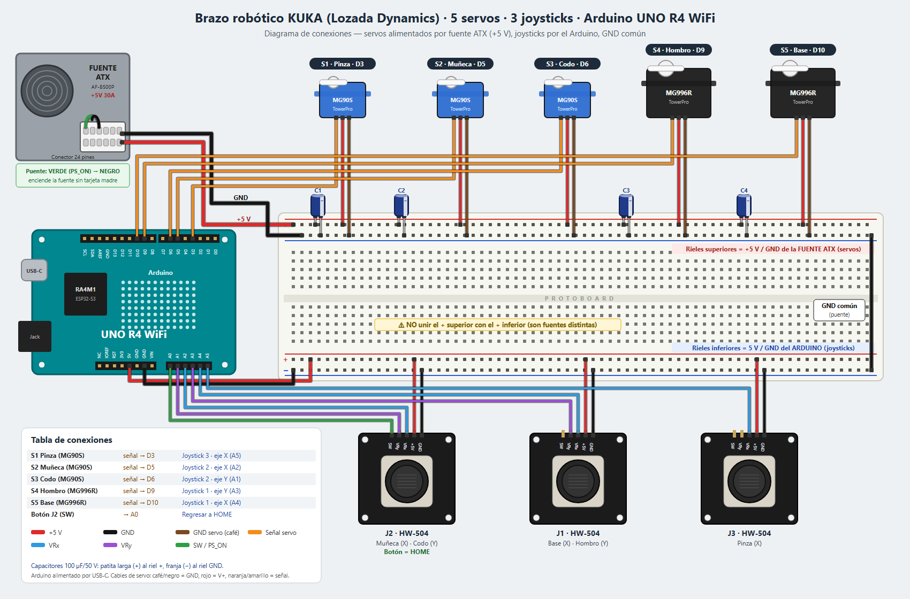
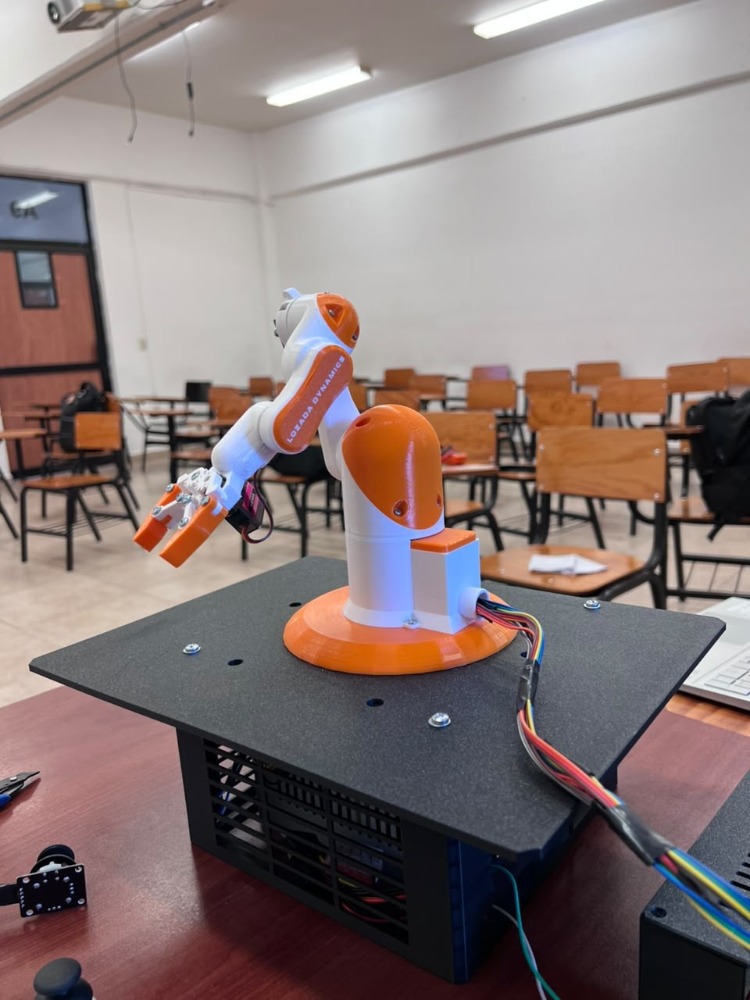
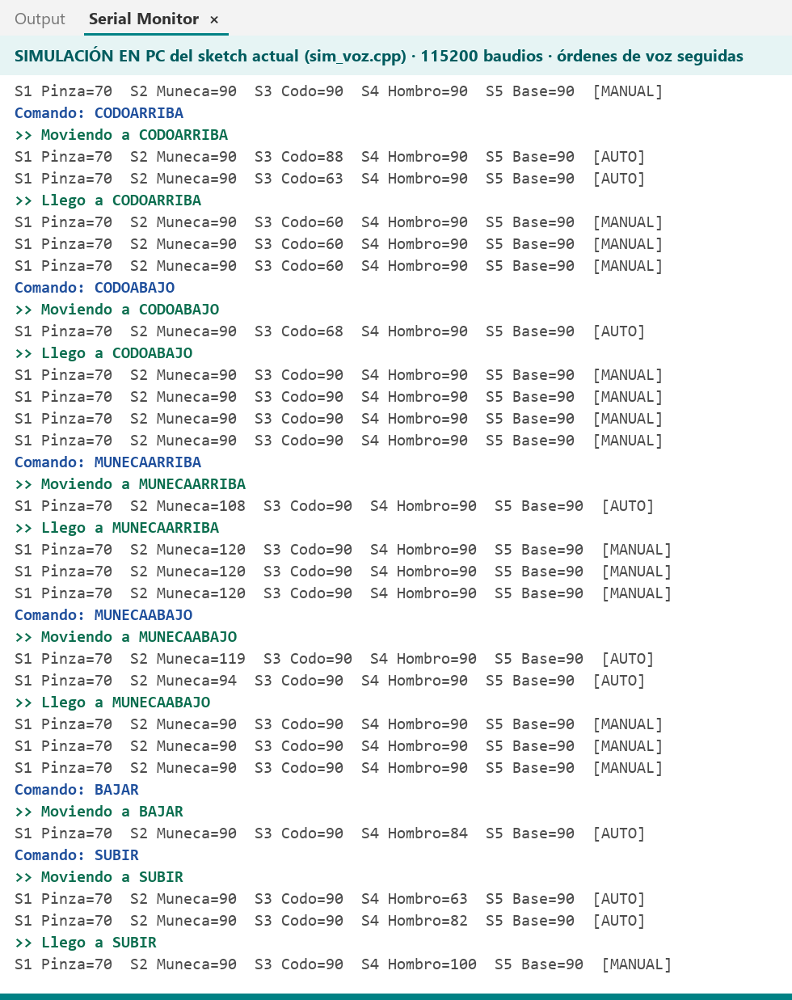
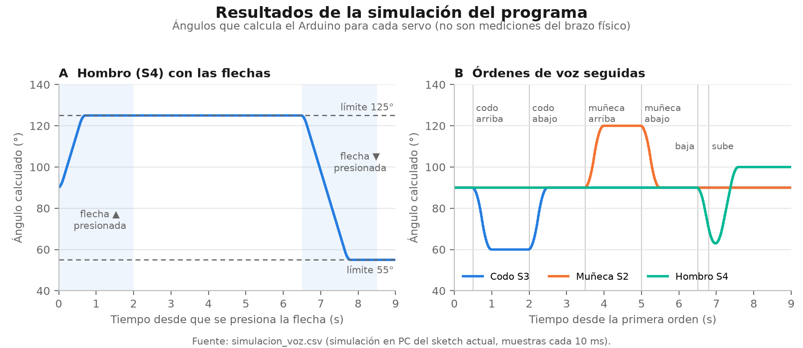

# Trabajo Final: Brazo robótico - Control manual por voz y gestos

## Descripción

El trabajo final de Sistemas Programables consiste en controlar un brazo robótico KUKA (Lozada Dynamics LDArmV2) impreso en 3D. Un Arduino UNO R4 WiFi controla cinco servomotores que mueven la base, el hombro, el codo, la muñeca y la pinza.

- **Control manual.** Tres joysticks físicos mueven las cinco articulaciones. El botón del joystick 2 devuelve el brazo a la posición inicial.
- **Control desde el teléfono.** La app de MIT App Inventor envía órdenes por Bluetooth Low Energy (BLE). Las flechas mueven el hombro, la base, el codo y la muñeca mientras se mantienen presionadas.
- **Voz y gestos.** Al tocar **HABLAR** se pueden dictar varias órdenes seguidas, como «codo arriba», «abre» o «alto». El brazo también ejecuta gestos programados con órdenes como «hola» y «beso».

## Objetivos

- Controlar cinco servomotores dentro del recorrido definido para cada articulación.
- Convertir los movimientos de los joysticks en ajustes graduales de velocidad.
- Comunicar el Arduino con la aplicación por Bluetooth LE para recibir órdenes de voz y de las flechas.
- Ejecutar movimientos de una articulación y gestos que coordinan varias articulaciones.
- Mostrar los ángulos que calcula el programa en la aplicación y en el Monitor Serie.

## Herramientas y material utilizado

- Arduino UNO R4 WiFi y Arduino IDE 2 con las librerías `Servo`, `ArduinoBLE` y `EEPROM`.
- Brazo Lozada Dynamics LDArmV2 impreso en 3D.
- Tres servomotores MG90S, dos MG996R y tres joysticks HW-504.
- Fuente ATX de 5 V, protoboard, cables Dupont y cuatro capacitores de 100 µF.
- Teléfono Android y MIT App Inventor con la extensión BluetoothLE.

## Diagrama

En el montaje, la fuente ATX de 5 V alimenta los servomotores y el Arduino alimenta los joysticks. Ambos circuitos comparten GND.

  

| Articulación | Pin del servo | Joystick y entrada | Recorrido |
| --- | --- | --- | --- |
| S1 · Pinza (MG90S) | D3 | Joystick 3, eje X (A5) | 20° a 110° |
| S2 · Muñeca (MG90S) | D5 | Joystick 2, eje X (A2) | 10° a 170° |
| S3 · Codo (MG90S) | D6 | Joystick 2, eje Y (A1) | 10° a 170° |
| S4 · Hombro (MG996R) | D9 | Joystick 1, eje Y (A3) | 55° a 125° |
| S5 · Base (MG996R) | D10 | Joystick 1, eje X (A4) | 5° a 175° |

El botón del joystick 2 se conecta a A0 y activa la posición inicial (`HOME`).

  

[Ver diagramas, fotografías y capturas](Diagrama/)

## Código

El programa de Arduino lee los joysticks, procesa los mensajes BLE y aplica los límites de cada articulación. Si la app deja de enviar mensajes de las flechas durante 400 ms, el programa cancela esa entrada. Los ángulos también se muestran en el Monitor Serie a 115200 baudios.

- [Ver código Arduino](Codigo/brazo_voz_ble/brazo_voz_ble.ino)
- [Ver proyecto editable de App Inventor (.aia)](Codigo/AppInventor/Brazo_KUKA_Voz7.aia)
- [Ver diseño y bloques de la aplicación](Codigo/AppInventor/)

## Reporte

El reporte describe el montaje, los comandos de la app, las pruebas físicas y de simulación, el problema con la alimentación y las conclusiones individuales.

[Ver reporte final del brazo robótico (PDF, 10 páginas)](Reporte/Reporte_Brazo_Robotico_KUKA.pdf)

## Resultados

En el brazo armado se comprobó el movimiento de las cinco articulaciones con los joysticks, el control mediante las flechas y la ejecución de varias órdenes de voz seguidas. Durante la prueba se registraron en el Monitor Serie los ángulos que reporta el programa.

En la simulación, la orden «codo arriba» movió el codo de 90° a 60° en 0.48 s. También se comprobó que las flechas del hombro respetaron los límites de 55° y 125°.

  
   
  Monitor Serie de la simulación del programa final.

  

Durante las pruebas físicas se corrigió el sentido de giro del codo. Algunos servos MG90S respondieron de forma irregular al probarlos por separado con la fuente ATX. Al conectar el circuito completo, los cinco servomotores funcionaron en conjunto.

## Video

El video muestra el brazo en funcionamiento con los joysticks, las flechas y la voz, además del montaje y el Monitor Serie.

- [Ver demostración en YouTube](https://youtu.be/huKdQpSx9oQ)
- [Ver carpeta Video](Video/)

## Conclusiones

El Arduino integró el control manual, las órdenes de voz y los gestos programados en un mismo sistema. La simulación permitió revisar los recorridos de las articulaciones. Las pruebas con el brazo armado permitieron corregir el movimiento del codo y comprobar la alimentación con los cinco servos conectados.
